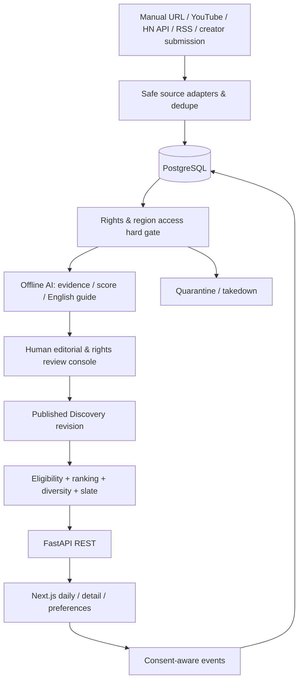

# Technical Architecture & Deployment — v0.1

## Architecture decision
**Modular monolith** rather than microservices. Keep source adapters separate from content decisions. Start with one Next.js app, one FastAPI process, Postgres and optional background worker. pgvector is P1, not prerequisite to a 100-item catalog.



## Stack
| Component | Decision | Reason |
|---|---|---|
| Web | Next.js, TypeScript, Tailwind, shadcn/ui | responsive + SEO/OG |
| API | FastAPI, Pydantic, SQLAlchemy, Alembic | typed Python and migrations |
| Database | PostgreSQL 16+ | relational provenance and slates |
| Jobs | cron first, Redis/RQ on queue need | durable retries without excessive ops |
| Semantic search | optional pgvector | small catalog fits SQL/filtering |
| AI | configurable provider + strict JSON schemas | offline drafts only |
| Telemetry | consent-aware PostHog or internal events, Sentry | minimal tracking |
| Deploy | container platform and managed DB | low-maintenance deployment |

## Ingestion contract
1. URL/ID manually provided or pulled from allowlisted providers.
2. Reject arbitrary URL fetches: HTTPS, known providers, safe DNS/IP, revalidate redirect, cap bytes/time.
3. Retrieve only authorized API/Feed fields, respect policy, rate limits and metadata cache TTL.
4. Normalize platform + external ID, canonical URL, attribution and language; idempotent upsert.
5. Record per-action rights and dated source evidence; default no copy, no translation, no rehost.
6. Check actual embed/link availability in target countries. HTTP 200 does not prove playback.
7. AI classification/quality/guide based on evidence level; auto queue for human editor.
8. Review, publish immutable experience revision, invalidate caches.

## State machine
`discovered -> metadata_ready -> rights_review -> editorial_draft -> human_review -> approved -> published`; exits `invalid | rejected | quarantined | unpublished`. Review and publication status are independent. A quarantine must override even a cached/persisted daily slate.

## Frontend flow
SSR public landing and shareable detail page. Client UI for player, saves and voluntary feedback. No autoplay. Source iframe must be official and untouched, with CSP host allowlist, safe embed ID and attribution. Use labeled external links for unsupported embeds. No arbitrary source HTML injection.

## Recommendation request
`GET /daily` → verify anonymous ID + UTC day → fetch existing slate or query eligible catalog → normalized rules score → diversity by creator/subject/source → store 1–3 ordered entries in transaction → response. Recheck current rights and availability on every read; if catalog insufficient show an honest fallback, not unpublished content.

## Deployment topology
HTTPS/CDN → Next.js → FastAPI → managed Postgres. Workers connect to Postgres and Redis. Dev via Compose; staging separate credentials; production isolated secrets and backups. Expected first-beta scale under 5k DAU and 500 candidates/day is an assumption not a benchmark.

## Operational requirements
- Public API p95 aim <500ms on warm DB/cache, excluding third-party player load.
- Request ID, structured logs, error monitoring, bounded retries and job failure alarms.
- API quotas, AI spend limits, source freshness deadlines, publication queue health.
- Backups plus restored staging test; migration backward compatibility and rollback.
- Rights disputes: emergency unpublish → invalidate cache → preserve legitimate audit trail → investigate.

## Security
SSRF-block localhost, metadata endpoints, RFC1918, IPv6 private/link-local and DNS-rebinding; no open proxy. Admin MFA/secure sessions/CSRF/RBAC. Rate limits, size caps, CSP, rel=noopener on links, no secrets in browser/build or git. Anonymous analytics, privacy retention/deletion and jurisdiction-appropriate consent.

## Repo target
```text
apps/web/ apps/api/
packages/ingestion/ packages/content_ai/
packages/rights/ packages/recommendation/
workers/ migrations/ tests/ infra/ docs/
```

No source/download credentials or user data belong in git.
